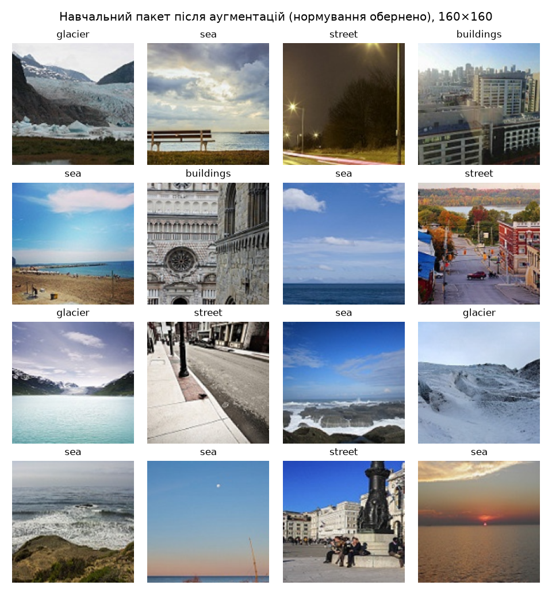
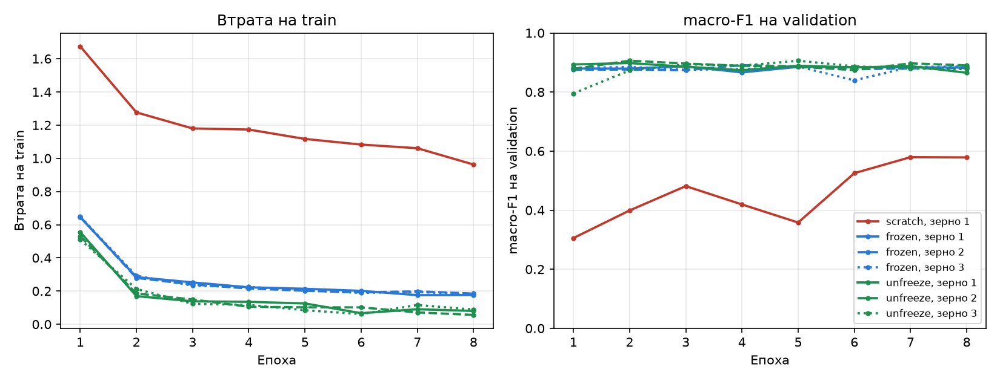
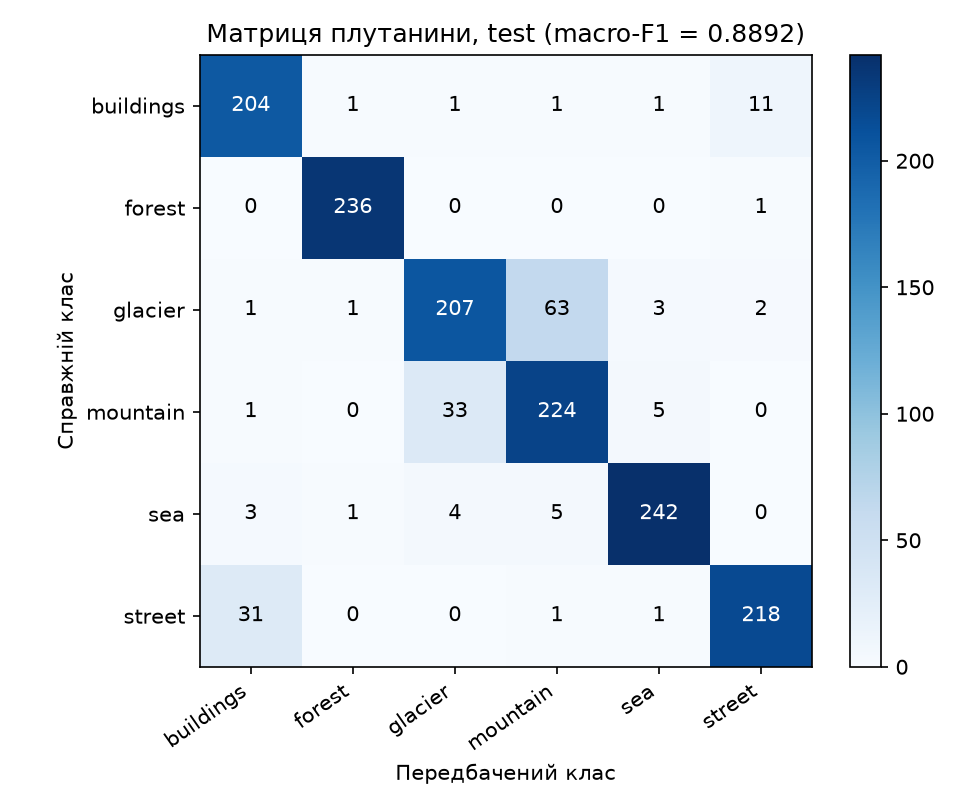
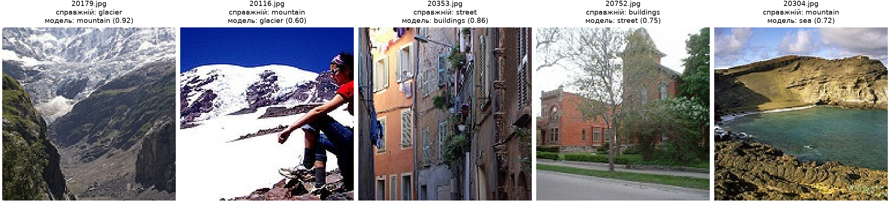

# ЛР3. Обчислювальний експеримент і трансферне навчання

У роботі порівнюються три режими навчання ResNet-18 (`scratch`, `frozen`, `unfreeze`) на датасеті Intel Image Classification. На кожен клас береться 200 зображень, а бюджет в усіх режимах однаковий: 304 кроки оптимізатора. Потрібно зʼясувати, скільки дають попередньо навчені ознаки ($\Delta_{\text{pre}}$), скільки додає донавчання кістяка під нову задачу ($\Delta_{\text{unf}}$) і чи перевищує кожна з цих різниць розкид між запусками.

## Структура теки

| Файл | Призначення |
|---|---|
| `common.py` | поділ, датасет, перетворення, побудова моделі за кроками 1–5, `set_train_mode`, macro-F1, журнал запуску |
| `train.py` | команда навчання: поділ, перевірки пунктів 1–2, сім запусків, журнали, вибір і `lab3_model.pt` |
| `analyze.py` | команда аналізу: хеш `split.csv`, таблиця, криві, ефекти, перевірка вибору, тестова оцінка на CPU |
| `pyproject.toml`, `uv.lock`, `.python-version` | версія Python 3.12 і зафіксовані версії залежностей |
| `split.csv` | поділ (`file`, `label`, `part`) |
| `checks/checks.md` | вивід перевірок пунктів 1–2 |
| `runs/<режим>_seed<зерно>/` | `run.json` і `val_logits.npy` ($1498 \times 6$) кожного запуску |
| `analysis/` | `analysis.md` (вивід аналізу), `test_results.json`, `test_logits.npy` |
| `figures/` | пакет після перетворень, криві, матриця плутанини, п'ять помилок |
| `lab3_model.pt` | ваги вибраного запуску (frozen, зерно 3), близько 45 МБ |

## Відтворення результатів

Датасет: [Intel Image Classification, Kaggle](https://www.kaggle.com/datasets/puneet6060/intel-image-classification). До репозиторію він не входить. Шлях до теки, де після розпакування лежать `seg_train/seg_train/<клас>/` і `seg_test/seg_test/<клас>/`, задається параметром `--data`.

Встановлення залежностей:

```
uv sync
```

Навчання (поділ, перевірки пунктів 1–2, сім запусків, журнали, вибір і збереження `lab3_model.pt`; test тут не використовується):

```
uv run python train.py --data <тека_набору>
```

Аналіз (перевірка хешу `split.csv`, таблиця, криві, ефекти, перевірка вибору, тестова оцінка на CPU, матриця плутанини, п'ять помилок):

```
uv run python analyze.py --data <тека_набору>
```

Для `train.py` можна також вказати `--device` (типово `auto`: cuda → mps → cpu) і `--skip-existing`, щоб після перерви не перенавчати вже готові запуски.

Запуски виконано з Python 3.12.14, torch 2.14.1, torchvision 0.29.1, numpy 2.5.4, scikit-learn 1.9.1, matplotlib 3.11.2 і pillow 13.0.0 (версії зафіксовано в `pyproject.toml` і `uv.lock`). Навчання проведено на Apple M1 Pro (MPS), а тестову оцінку на CPU, обчислення у `float32`.

Числа у звіті взято зі збережених журналів у `runs/` і з виводу команди аналізу (`analysis/analysis.md`).

## 1. Перевірки до навчання

### Поділ

Поділ побудовано за процедурою з умови. Імена файлів кожного класу сортуються як рядки. Для train один генератор `np.random.default_rng(0)` проходить усі класи по черзі, і до навчальної частини потрапляють файли `idx[:200]`. Для validation і test створюється новий `np.random.default_rng(0)`, а межею між частинами є `cut = n_k // 2`. У клітинках таблиці наведено кількість файлів і суму їхніх числових імен.

| Клас | train | validation | test | Збіг |
|---|---|---|---|---|
| buildings | 200 / 1 996 761 | 218 / 4 837 323 | 219 / 4 837 559 | так |
| forest | 200 / 2 032 625 | 237 / 5 276 962 | 237 / 5 291 326 | так |
| glacier | 200 / 2 183 923 | 276 / 6 135 652 | 277 / 6 157 250 | так |
| mountain | 200 / 1 950 345 | 262 / 5 789 535 | 263 / 5 849 765 | так |
| sea | 200 / 1 987 613 | 255 / 5 655 068 | 255 / 5 668 011 | так |
| street | 200 / 1 841 817 | 250 / 5 541 845 | 251 / 5 547 533 | так |
| Разом | 1200 / 11 993 084 | 1498 / 33 236 385 | 1502 / 33 351 444 | |

Усі 18 клітинок збіглися з контрольною таблицею. Перетинів між частинами немає: у `split.csv` 4200 рядків і стільки ж унікальних імен. SHA-256 файлу: `d3a611aec41f6e335ab58287f10a443f3e0e35aa9adfefae662d48b15af567f9`.

### Пакет після перетворень



На рисунку показано перші 16 зображень навчального пакета в тому вигляді, в якому їх отримує модель: після `RandomResizedCrop(160, scale=(0.7, 1.0))` і горизонтального віддзеркалення. Для показу нормування ImageNet обернено. Мітки відповідають вмісту зображень, а кольори виглядають природно, отже, нормування застосовано правильно.

### Початкова втрата $L_0$

Втрату обчислено для зерна 1 на першому пакеті навчального завантажувача після `set_train_mode`, під `torch.no_grad()` і до першого кроку оптимізатора.

| Режим | $L_0$ | $L_0 - \ln 6$ | std логітів | середня max-ймовірність |
|---|---|---|---|---|
| scratch | 2.1344 | +0.343 | 0.504 | 0.286 |
| frozen | 2.2155 | +0.424 | 0.671 | 0.326 |

Значення $\ln 6 \approx 1.7918$ відповідає моделі, яка дає всім класам однакову ймовірність $1/6$, а це можливо лише за однакових логітів. Голова `fc` ініціалізована випадково, тому логіти розрізняються (std 0.5–0.7), а середня максимальна ймовірність становить 0.29–0.33 замість $1/6 \approx 0.17$. Модель уже надає перевагу випадковому класу, і через опуклість крос-ентропії такий розкид у середньому підвищує втрату над $\ln 6$. У режимі frozen відхилення більше, оскільки логіти мають ширший розкид (0.67 проти 0.50). Найімовірніше, причина в тому, що ознаки ImageNet після `avgpool` мають більший масштаб, ніж ознаки випадкового кістяка. Відхилення на 0.3–0.4 не вказує на помилку; підозрілим було б значення $L_0$, у кілька разів більше за $\ln 6$, наприклад через ненормовані входи.

## 2. Перевірка режимів навчання

### Параметри

Кількість параметрів рахується як сума `numel()`.

| Режим | Усього | requires_grad=True | Групи AdamW (параметрів, швидкість навчання) | Збіг з таблицею | Заморожених в оптимізаторі |
|---|---|---|---|---|---|
| scratch | 11 179 590 | 11 179 590 | усі: 11 179 590, $3 \cdot 10^{-3}$ | так | 0 |
| frozen | 11 179 590 | 3 078 | fc: 3 078, $3 \cdot 10^{-3}$ | так | 0 |
| unfreeze | 11 179 590 | 8 396 806 | fc: 3 078, $3 \cdot 10^{-3}$; layer4: 8 393 728, $3 \cdot 10^{-4}$ | так | 0 |

В оптимізатор передаються лише параметри з `requires_grad=True`. Перевірка показала, що заморожених параметрів у ньому немає, а кожен навчуваний входить до однієї з груп. В усіх групах використано AdamW з `weight_decay=1e-4`.

### Що змінюється за 5 кроків

Для кожного режиму створено новий екземпляр моделі із зерном 1 і збережено копію повного `state_dict()`. Після виклику `set_train_mode` виконано 5 кроків на перших 5 пакетах, а параметри й ковзні статистики порівняно точно, через `torch.equal`.

| Режим | Модуль | Параметри змінилися | Ковзні статистики BN змінилися | Збігається з очікуваним |
|---|---|---|---|---|
| frozen | conv1 | ні | немає BN | так |
| frozen | bn1 | ні | ні | так |
| frozen | layer1 | ні | ні | так |
| frozen | layer2 | ні | ні | так |
| frozen | layer3 | ні | ні | так |
| frozen | layer4 | ні | ні | так |
| frozen | fc | так | немає BN | так |
| unfreeze | conv1 | ні | немає BN | так |
| unfreeze | bn1 | ні | ні | так |
| unfreeze | layer1 | ні | ні | так |
| unfreeze | layer2 | ні | ні | так |
| unfreeze | layer3 | ні | ні | так |
| unfreeze | layer4 | так | так | так |
| unfreeze | fc | так | немає BN | так |

Результат збігся з очікуваним. Модулі в `eval()` не змінилися зовсім, у навчуваних модулях змінилися параметри, а в `layer4` режиму unfreeze також ковзні статистики BN.

### Дослід із навмисною помилкою: frozen з `model.train()`

**Прогноз (записано до запуску).** Параметри замороженого кістяка не зміняться, бо вони мають `requires_grad=False` і не входять до оптимізатора. Натомість усі BN кістяка (`bn1`, `layer1`–`layer4`) у режимі `train()` на кожному прямому проході оновлюватимуть `running_mean` і `running_var` за статистиками наших пакетів, тому буфери зміняться в усіх модулях з BN. Отже, кістяк уже не буде повністю замороженим: у `eval()` ознаки обчислюватимуться за іншими статистиками, ніж на ImageNet. На кривій втрати на train цього не буде видно, оскільки в `train()` BN нормує за статистиками поточного пакета, а не за ковзними. Різниця проявиться лише в `eval()`, тобто на validation і test.

**Результат.**

| Модуль | Параметри змінилися | Ковзні статистики BN змінилися |
|---|---|---|
| conv1 | ні | немає BN |
| bn1 | ні | так |
| layer1 | ні | так |
| layer2 | ні | так |
| layer3 | ні | так |
| layer4 | ні | так |
| fc | так | немає BN |

У шарі `layer1.0.bn1` після 5 кроків максимальна абсолютна зміна `running_mean` становить 0.0886, а `running_var` — 0.1484; `num_batches_tracked` збільшився на 5. Прогноз підтвердився: параметри кістяка не змінилися, а ковзні статистики змінилися в усіх пʼяти модулях з BN.

**Чому `requires_grad=False` не захищає ці значення.** `running_mean` і `running_var` є буферами, а не параметрами. Їх оновлює не оптимізатор, а сам шар BN під час прямого проходу, якщо модуль перебуває в режимі `train()`:

$$\text{running} \leftarrow (1 - m) \cdot \text{running} + m \cdot \text{статистика пакета}, \qquad m = 0.1.$$

Прапорець `requires_grad` стосується лише обчислення градієнтів і на це оновлення не впливає. Зафіксувати статистики можна тільки режимом `eval()`, тому `set_train_mode` і переводить у нього заморожені модулі.

**Чому для `layer4` у режимі unfreeze оновлення правильне.** Ваги `layer4` навчаються, тому розподіл активацій усередині нього змінюється з кожним кроком, а на вхід надходять наші зображення, а не ImageNet. Статистики BN мають відповідати поточним вагам і цим даним. Якби `layer4` залишався в `eval()`, нормування виконувалося б за старими статистиками ImageNet, хоча ваги вже інші.

## 3. Сім запусків

Кожен запуск починається з `torch.manual_seed(seed)` і `np.random.seed(seed)`, після чого модель будується за кроками 1–5. Далі йдуть 8 епох по 38 кроків, разом 304 кроки. На початку кожної епохи викликається `set_train_mode`, а після неї обчислюється macro-F1 на validation. Використано ваги після 8-ї епохи, вибір епохи не виконувався. Журнали збережено в `runs/<режим>_seed<зерно>/run.json`, а логіти validation після 8-ї епохи — у `val_logits.npy`.

| # | Режим | Зерно | Втрата train, епоха 8 | macro-F1 validation, епоха 8 | Час навчання, с |
|---|---|---|---|---|---|
| 1 | scratch | 1 | 0.9624 | 0.5787 | 48 |
| 2 | frozen | 1 | 0.1759 | 0.8829 | 18 |
| 3 | frozen | 2 | 0.1848 | 0.8814 | 18 |
| 4 | frozen | 3 | 0.1788 | 0.8864 | 17 |
| 5 | unfreeze | 1 | 0.0802 | 0.8652 | 22 |
| 6 | unfreeze | 2 | 0.0563 | 0.8903 | 22 |
| 7 | unfreeze | 3 | 0.0887 | 0.8774 | 23 |

У таблиці вказано час лише 304 кроків оптимізатора. З оцінкою на validation після кожної епохи запуски тривали 68 с (scratch), 36–37 с (frozen) і 41–43 с (unfreeze).



## 4. Розклад ефектів

Для режимів frozen і unfreeze обчислено середнє та розмах за трьома зернами, а за поріг шуму взято більший із двох розмахів:

$$\bar F_r = \frac{1}{3} \sum_{s=1}^{3} F_{r,s}, \qquad R_r = \max_s F_{r,s} - \min_s F_{r,s}, \qquad R = \max(R_{\text{frozen}},\ R_{\text{unfreeze}}).$$

Ефект попереднього навчання та ефект розморожування визначено так:

$$\Delta_{\text{pre}} = \bar F_{\text{frozen}} - F_{\text{scratch},1}, \qquad \Delta_{\text{unf}} = \bar F_{\text{unfreeze}} - \bar F_{\text{frozen}}.$$

| Величина | Значення |
|---|---|
| $\bar F_{\text{frozen}}$, $R_{\text{frozen}}$ | 0.8836, 0.0051 |
| $\bar F_{\text{unfreeze}}$, $R_{\text{unfreeze}}$ | 0.8776, 0.0251 |
| $R$ | 0.0251 |
| $\Delta_{\text{pre}}$ | +0.3049 |
| $\Delta_{\text{unf}}$ | −0.0059 |
| $\Delta_{\text{pre}} + \Delta_{\text{unf}} = \bar F_{\text{unfreeze}} - F_{\text{scratch},1}$ | +0.2990 |

- $\Delta_{\text{pre}} = +0.305 > R = 0.025$ (у 12.1 раза): ефект вартий перевірки, але не доведений.
- $|\Delta_{\text{unf}}| = 0.006 \le R = 0.025$: різниця не відрізняється від розкиду, результату немає.

**Вплив зерна.** `torch.manual_seed(seed)` задає початкові ваги, порядок пакетів (перемішування використовує глобальний генератор PyTorch) і випадкові аугментації. `np.random.seed` у цьому коді на результат не впливає, бо поділ має власний генератор. У режимі scratch зерно визначає ініціалізацію всіх 11.2 млн ваг. У режимах frozen і unfreeze ваги кістяка беруться з ImageNet, тому від зерна залежить лише ініціалізація `fc`. Порядок пакетів і аугментації залежать від зерна в усіх трьох режимах.

**Розкид у frozen і unfreeze.** У режимі frozen ознаки фіксовані й навчається лише лінійна голова з 3 078 параметрів. Це задача, близька до логістичної регресії, і з різних початкових точок вона приходить до схожого розвʼязку, тому $R_{\text{frozen}} = 0.005$. У режимі unfreeze навчаються ще 8.4 млн ваг `layer4`, тож задача неопукла, а траєкторія й ковзні статистики BN залежать від порядку пакетів. Значення між епохами теж зазвичай коливаються на 0.01–0.03: наприклад, запуск 5 мав 0.888 після 7-ї епохи і 0.865 після 8-ї. Оскільки вибір епохи не виконується, ці коливання потрапляють у підсумок, і $R_{\text{unfreeze}} = 0.025$ приблизно у 5 разів більше.

**Розкид запуску 1.** $R$ виміряно на запусках, що починаються з однакового попередньо навченого кістяка, тому він не описує розкид режиму scratch. Для scratch є лише один запуск, тож його розкид за зернами невідомий. Найімовірніше, він більший, бо зерно задає всю ініціалізацію, а мережа на 1200 зображеннях ще не збіглася. На це вказує крива запуску 1: macro-F1 на validation зростає нерівномірно (0.306, 0.399, 0.481, 0.419, 0.358, 0.525, 0.580, 0.579), зміна між сусідніми епохами сягає 0.17, а втрата на train (0.96) ще спадає. Однак $\Delta_{\text{pre}} = 0.305$ значно більше за ці коливання, тому напрям висновку не змінюється. Менш точною є лише сама величина $\Delta_{\text{pre}}$.

**Бюджет за часом.** Однаковою в режимах є лише кількість кроків оптимізатора (304), а час навчання різний: у середньому 48 с у scratch, 22 с в unfreeze і 17 с у frozen. Режим frozen приблизно в 2.7 раза дешевший за scratch, бо градієнти обчислюються лише для `fc`. В unfreeze вони проходять ще через `layer4`, а в scratch — через усю мережу. Запуск scratch виконувався першим, тому його час включає й первинне декодування частини зображень у кеш, отже, різниця дещо завищена.

## 5. Вибір конфігурації і тестова оцінка

**Вибір** виконано в `train.py` лише за validation. Найбільше середнє $\bar F_r$ має режим frozen (0.8836 проти 0.8776 в unfreeze і 0.5787 у scratch), а серед його запусків найкращий результат дає зерно 3 (0.8864). Ваги цього запуску збережено в `lab3_model.pt` як словник з ключами `state_dict`, `regime`, `seed`, `classes` та `img_size` (160).

Оскільки $|\Delta_{\text{unf}}| = 0.006 \le R = 0.025$, **вибір між frozen і unfreeze визначив шум**. Процедура від цього не змінюється, проте вважати перевагу frozen результатом не можна.

`analyze.py` перевіряє за журналами, що `lab3_model.pt` відповідає правилу вибору (перевірку пройдено), і порівнює логіти validation, обчислені на CPU, зі збереженими в `runs/frozen_seed3/val_logits.npy`, які отримано на MPS. Максимальна різниця становить $5 \cdot 10^{-5}$, а передбачення й macro-F1 (0.8864) однакові. Після цієї перевірки один раз обчислюється test на CPU.

| Величина | Значення |
|---|---|
| macro-F1 на test | **0.8892** |
| macro-F1 вибраного запуску на validation | 0.8864 |
| test − validation | +0.0028 |
| accuracy на test | 0.8862 |
| стандартна похибка $\sqrt{p(1-p)/n}$, $n = 1502$ | 0.0082 |

Матриця плутанини на test (рядки — справжній клас, стовпці — передбачений):

| справжній \ передбачений | buildings | forest | glacier | mountain | sea | street |
|---|---|---|---|---|---|---|
| **buildings** | 204 | 1 | 1 | 1 | 1 | 11 |
| **forest** | 0 | 236 | 0 | 0 | 0 | 1 |
| **glacier** | 1 | 1 | 207 | 63 | 3 | 2 |
| **mountain** | 1 | 0 | 33 | 224 | 5 | 0 |
| **sea** | 3 | 1 | 4 | 5 | 242 | 0 |
| **street** | 31 | 0 | 0 | 1 | 1 | 218 |



**Зміщення від вибору найкращого запуску.** Вибір найкращого з трьох запусків робить його значення на validation оптимістичним: $F = 0.8864$ у запуску 4 на 0.003 перевищує середнє режиму. На test цього зміщення не видно: значення навіть трохи вище (0.8892 проти 0.8864). Стандартна похибка частки правильних відповідей на 1502 зображеннях становить 0.0082, тож розбіжність у межах ±0.016 можна пояснити лише скінченністю вибірок. Оскільки розкид у режимі frozen малий, очікуване зміщення теж мале й губиться в цьому шумі. Крім того, validation і test є різними випадковими половинами `seg_test`, а частина переваги запуску 4 може бути справжньою властивістю його ваг. Тому зміщення може бути непомітним або навіть мати протилежний знак.

### Пʼять характерних помилок

Для аналізу взято пʼять найчастіших позадіагональних пар (за однакової кількості — у порядку зростання індексу справжнього, потім передбаченого класу) і для кожної пари перший за іменем файл test з такою помилкою.

| Файл | Справжній клас | Передбачений клас | Імовірність передбаченого класу | Кількість таких помилок у test |
|---|---|---|---|---|
| 20179.jpg | glacier | mountain | 0.9199 | 63 |
| 20116.jpg | mountain | glacier | 0.5996 | 33 |
| 20353.jpg | street | buildings | 0.8640 | 31 |
| 20752.jpg | buildings | street | 0.7497 | 11 |
| 20304.jpg | mountain | sea | 0.7211 | 5 |



1. **20179.jpg, glacier → mountain:** сцена містить обидва класи: язик льодовика лежить у долині між скелястими схилами, які займають більшу частину кадру.
2. **20116.jpg, mountain → glacier:** сцена містить обидва класи: за людиною на передньому плані видно вершину, майже повністю вкриту снігом і льодом.
3. **20353.jpg, street → buildings:** сцена містить обидва класи: це вузька вулиця, але кадр майже повністю заповнюють фасади будинків.
4. **20752.jpg, buildings → street:** сцена містить обидва класи: цегляні будівлі стоять за деревами, а передній план займає дорога з тротуаром.
5. **20304.jpg, mountain → sea:** сцена містить обидва класи: скелясті схили оточують бухту, і вода займає значну частину кадру.

Плутанина glacier ↔ mountain (63 + 33 = 96 зі 171 помилки на test) є властивістю набору: на знімках льодовиків часто видно гори, а на знімках гір — сніг і лід, тому межа між цими класами в розмітці нечітка. Виправляти її не потрібно.

## Висновки

1. **Попередньо навчені ознаки ($\Delta_{\text{pre}}$).** Ознаки ImageNet дають кращий результат, ніж навчання з нуля. Виграш становить $\Delta_{\text{pre}} = +30.5$ пункту macro-F1 ($\bar F_{\text{frozen}} = 0.884$ проти $F_{\text{scratch},1} = 0.579$), що у 12.1 раза більше за $R = 0.025$. За правилом інтерпретації цей ефект вартий перевірки, але не доведений. Додаткове обмеження полягає в тому, що для scratch є лише один запуск і його розкид не виміряно, хоча коливання кривої між епохами (до 0.17) значно менші за $\Delta_{\text{pre}}$.
2. **Донавчання кістяка ($\Delta_{\text{unf}}$).** Розморожування `layer4` дає формально відʼємний і дуже малий ефект: $\Delta_{\text{unf}} = -0.6$ пункту macro-F1 ($\bar F_{\text{unfreeze}} = 0.878$ проти $\bar F_{\text{frozen}} = 0.884$). За модулем це приблизно в 4 рази менше за $R = 0.025$, тому різниця не відрізняється від розкиду і результату немає. Значення 0.889 на test стосується лише вибраного запуску frozen, тому порівняння режимів воно не змінює.
3. **Бюджет.** Обидва ефекти виміряно за бюджету в 304 кроки оптимізатора. Втрата scratch після 8 епох ще спадає (0.96), тому з довшим навчанням цей режим міг би скоротити відставання. Отже, $\Delta_{\text{pre}}$ стосується саме короткого навчання на 1200 зображеннях.
4. **Вибір режиму.** Для нової задачі з 200 зображеннями на клас я обрала б frozen. За якістю він не відрізняється від unfreeze (0.884 проти 0.878 при $R = 0.025$), має приблизно у 5 разів менший розкид між зернами (0.005 проти 0.025) і навчається приблизно в 1.3 раза швидше (17 с проти 22 с).

## Відтворюваність і відхилення

- **Ваги ImageNet** завантажуються стандартно через `torchvision.models.resnet18(weights=ResNet18_Weights.IMAGENET1K_V1)`.
- **Кешування зображень.** `SplitDataset` один раз відкриває кожне зображення через `Image.open(...).convert("RGB")` і зберігає його в памʼяті, а аугментації застосовуються при кожному зверненні заново. Це лише прискорює епоху і на результат не впливає.
- **Коміт коду.** Усі сім журналів записано з комітом `1a7bec7` без незакомічених змін (`uncommitted_changes: false`). Результати й цей звіт додано наступним комітом, код у ньому не змінювався.
- **Повторне навчання і вибір конфігурації.** Перевірки пунктів 1–2 відтворюють той самий `split.csv` (побітово) і ті самі відповіді «так / ні». Значення macro-F1 після повторного навчання можуть відрізнятися, бо обчислення на GPU і MPS недетерміновані й залежать від версій бібліотек. Оскільки $|\Delta_{\text{unf}}| \le R$, правило вибору може цього разу обрати unfreeze замість frozen. Висновки у звіті зроблено за збереженими журналами.
- **Попередні запуски.** Раніше сім запусків уже виконувалися за цим самим протоколом на CPU. Тоді правило вибрало unfreeze, зерно 3, і для цієї моделі було обчислено test. Повторне навчання виконано лише для того, щоб журнали посилалися на коміт цього репозиторію. Поділ, зерна, налаштування й правило вибору не змінювалися, а результат test на них не вплинув. Зміна вибору на frozen узгоджується з $|\Delta_{\text{unf}}| \le R$.
- **Час навчання** виміряно на Apple M1 Pro (MPS); на CPU чи іншому GPU він буде іншим.

## Джерела

- Документація PyTorch і torchvision: `resnet18`, `BatchNorm2d`, `AdamW`, `transforms`
- Документація scikit-learn: `f1_score`, `confusion_matrix`
- Датасет: Intel Image Classification. Kaggle: https://www.kaggle.com/datasets/puneet6060/intel-image-classification
- Генеративний інструмент Claude (Anthropic) використано для допомоги з кодом і текстом звіту
